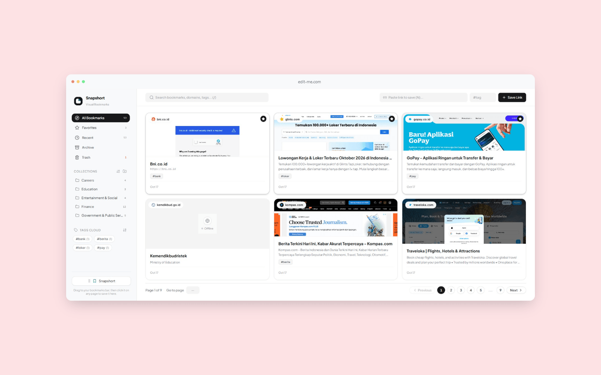
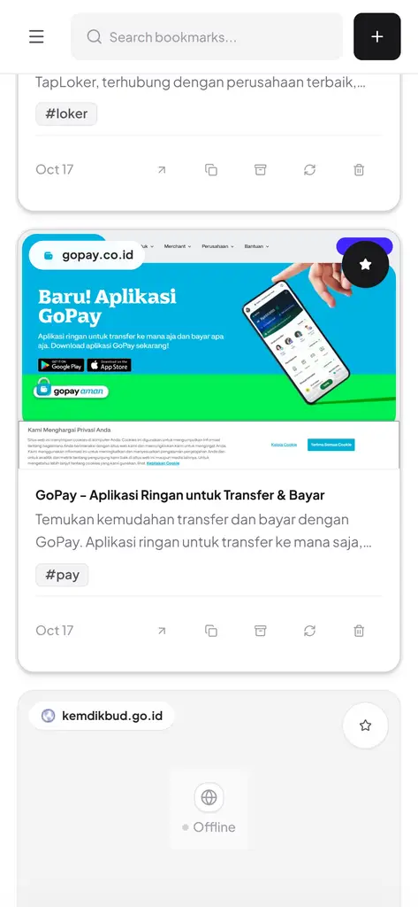

# Snapshort

**A visual bookmark manager.** Paste a link and a headless browser captures a screenshot of the
page, so your bookmarks are recognised by how they *look* rather than by title alone.

Single-user and local-first: one Next.js process, one SQLite file, no accounts, no cloud.



---

## Why

Bookmark lists all look the same after a hundred entries. A title like "Berita Terkini" tells you
nothing about which site it is. Snapshort keeps a picture of every page, so you find things by
recognition — the layout, the logo, the hero image — the way you find a tab you left open.

## Features

**Capture**
- Headless Chromium renders each page and stores a compressed WebP preview.
- Waits for real content — `load`, a bounded quiet-network window, every ``, and
  `document.fonts.ready` — so previews are never captured half-rendered.
- Title, description and favicon are read from the page itself.
- Blank or white-only renders are detected and retried instead of being saved as a "success".
- An SSRF guard rejects local, private and link-local addresses before anything navigates.

**Organise**
- Five views: All Bookmarks, Favorites, Recent, Archive, Trash.
- Collections with one level of subcollections. A parent lists its own bookmarks plus everything
  in its children; a child lists only its own.
- Tags with usage counts. Monochrome pills, because colour is reserved for status.
- Drag a card onto a collection to file it; drag onto the floating target to remove it.
- Sort collections and tags A–Z or by most used.

**Read and edit**
- Click any card to open an editor: title, collection, URL, description and tags, with the
  captured preview beside them.
- Changes save on close; unchanged fields are not written.
- Search across title, URL and description; filter by tag or collection.
- A bookmarklet in the sidebar saves the page you are currently on.

**Interface**
- Uniform 3×2 grid of six equal cards per page, no page scrolling.
- Keyboard: `/` focuses search, `N` focuses the paste field, `Esc` cancels dialogs.
- A queue indicator in the header shows how many previews are rendering and how many wait.

## On a phone

The same app, re-laid out: an off-canvas drawer, a single scrolling column, and a bottom sheet for
adding a link.

<center?
<p>
  
  &nbsp;&nbsp;
</p>
</center>

The drawer never scrolls as a whole — only the collections and tag lists inside it do — so the
brand, the five views and the tag cloud stay put. Card actions are always visible and every
control is at least 44px, because a hover-only control does not exist on a touch screen.

---

## Requirements

- Node.js 20+ (developed on 22)
- pnpm 11+
- A Chromium build for Playwright — only if you capture locally
  (`pnpm exec playwright install chromium`)

## Getting started

```bash
pnpm install
pnpm exec playwright install chromium   # skip if you use an external screenshot API
pnpm dev
```

Open <http://localhost:3000>. The database file and its schema are created on first request.

Optional sample data (**deletes existing rows first**):

```bash
bun scripts/seed.ts
```

Optional — import a curated set of Indonesian sites into a two-level collection tree:

```bash
bun scripts/import-indonesian-sites.ts
```

## Configuration

Everything is optional; the defaults suit a laptop. Copy `.env.example` to `.env.local` and edit.
The values that matter most:

| Variable | Default | What it does |
|---|---|---|
| `CAPTURE_ENABLED` | `true` | `false` runs the app as a plain bookmark manager: no previews, no queue, no retry button |
| `CAPTURE_PROVIDER` | `local` | Comma-separated chain, tried in order. `local,thum,sb` renders here, falls back to a keyless service, then to a keyed one |
| `CAPTURE_CONCURRENCY` | `2` | Parallel captures. A chain containing `local` is capped at 2 regardless |
| `CAPTURE_DEADLINE_MS` | `60000` | Hard ceiling for one bookmark across the whole chain. Past it, the capture fails so the queue keeps moving |
| `CAPTURE_REJECT_BLANK` | `true` | Reject near-white renders and try the next provider |

The three providers:

| Slot | Renderer | Cost | Metadata |
|---|---|---|---|
| `local` | Chromium on this machine | ~280MB disk, 150–250MB RAM per page | Title, description, favicon from the page |
| `thum` | [thum.io](https://thum.io) — no key needed | One request per capture | Image only |
| `sb` | [screenshotbase](https://screenshotbase.com) — free key | One request per capture | Image only |

A chain containing `local` is capped at two concurrent captures; API-only chains honour
`CAPTURE_CONCURRENCY`. When a capture returns an image but no metadata, the page's own `<title>`,
`og:description` and first paragraph are read over plain HTTP — no API quota, works for every slot.

Sending URLs to a third party is a privacy decision, so it is opt-in and never a default.

## Scripts

| Command | What it does |
|---|---|
| `pnpm dev` | Development server with Turbopack |
| `pnpm build` | Production build |
| `pnpm start` | Serve the production build |
| `pnpm lint` | ESLint over `src` |
| `pnpm exec tsc --noEmit` | Type check |
| `bun scripts/seed.ts` | Reset the database with sample data |
| `bun scripts/import-indonesian-sites.ts` | Import a curated site tree (idempotent) |

---

## Architecture

```
src/
  app/
    page.tsx              single client page: state, data fetching, handlers
    layout.tsx            fonts, metadata, icon bundle
    api/
      bookmarks/          list + create (POST queues a capture)
      bookmarks/[id]/     read, update, permanent delete
      bookmarks/[id]/action   favourite / archive / trash / restore
      bookmarks/[id]/click    visit counter
      bookmarks/[id]/retry    re-run capture
      folders/            collections and subcollections
    screenshots/[file]/   serves captures written after the build
  components/
    Sidebar.tsx           views, collections, tag cloud, bookmarklet
    Header.tsx            search, paste-link, queue indicator
    BentoGrid.tsx         card grid, card renderer, pagination
    PreviewDrawer.tsx     editor with inline preview
    FlipList.tsx          animates list reordering (FLIP)
  db/
    index.ts              connection, pragmas, migrations
    schema.ts             table definitions and row types
    queries.ts            reads, status writes, queue queries
    update.ts             bookmark updates, including tag linking
  lib/
    capture.ts            queue, status writes, boot recovery
    captureProviders.ts   Chromium renderer and API slots
    blankImage.ts         detects white-only renders
    pageMetadata.ts       title and description from the page's HTML
    config.ts             environment configuration
    ssrf.ts               URL safety validation
    usePresence.ts        mount/unmount transition helper
```

### Data model

```
folders ──< folders            (self-referencing parent_id, one level of nesting)
folders ──< bookmarks          (folder_id, ON DELETE SET NULL)
bookmarks ──< bookmark_tags ──< tags
```

- `bookmarks` carries `is_favorite`, `is_archived`, `is_deleted` and a `click_count` visit counter.
- `url_hash` is unique, so saving the same link twice returns `409`.
- SQLite runs in WAL mode with foreign keys enabled.

### The capture queue

1. `POST /api/bookmarks` validates the URL (scheme, DNS, SSRF ranges) and inserts the row as
   `pending`.
2. The request returns immediately; the queue picks the row up in the background.
3. The worker renders, waits for assets, writes the image and settles the row as `ready` or
   `failed`. **Every path settles the row** — a failed browser launch or an API error is recorded,
   never left escaping as an unhandled rejection.
4. The grid shows `Queued...` for `pending`, a spinner for `capturing`, the image for `ready`, and
   a retry button for `failed`. While anything is unsettled the client refetches, so a capture that
   finishes in the background appears without a manual refresh.
5. The work list **is the database**, re-read on each pass. Rows written by a script or an import
   — which never went through the API — are picked up too, so nothing can be forgotten.

### Screenshots and the database

Both are generated at runtime and **not** tracked in git:

- `snapshort.db` (plus `-wal` and `-shm`) — local data.
- `public/screenshots/*` — captured previews.

Deleting either is safe; they are rebuilt as you use the app. Captures are served by
`src/app/screenshots/[file]/route.ts` rather than from `public/`: `next start` serves `public/` as
a build-time snapshot, so a file written after the build would otherwise return 404.

---

## Responsive behaviour

The breakpoint is `lg` (1024px). Above it the app is the fixed desktop board; below it the layout
switches to a phone layout.

| | Desktop (≥1024px) | Mobile (<1024px) |
|---|---|---|
| Navigation | Sidebar always visible | Off-canvas drawer behind a hamburger; closed only on request (scrim, `Esc`, or browser Back) — picking an item leaves it open so subcollections stay visible |
| Cards | Uniform 3×2 board, 6 per page | Single column, vertical scroll, no pagination |
| Card actions | Revealed on hover | Always visible, 44px targets |
| Bookmarklet | Shown in the sidebar footer | Hidden (needs a desktop bookmarks bar) |
| Collection actions | Revealed on hover | Always visible, tightly grouped, 44px targets |
| Add a link | Inline paste + tag fields | Dark `+` beside the search opens a bottom sheet |
| Pagination | Footer with page controls | Hidden |
| Collection / tag lists | Capped height, own scroll | Take the leftover height, scroll internally; the drawer never scrolls |
| Editor | Centred panel, preview beside fields | Full-screen sheet, single column |
| Filing into a collection | Drag a card onto a collection | Editor's Collection field (HTML5 drag does not fire on touch) |

Touch-specific rules use Tailwind's `pointer-coarse:` variant, so pointer devices keep the denser
desktop styling.

## Conventions

- **Colour carries meaning.** Emerald marks the primary action and recovery, red marks
  destructive actions, amber marks in-progress state. Everything else is zinc.
- **Selection changes are instant.** Rows and pills do not cross-fade; only hover and press
  states animate. Fading a dark pill out while the next fades in reads as a flicker.
- **Content does not fade on view switches.** Refetches swap the cards in one commit.
- **Form controls are filled, never outlined.** One shared `FIELD_CLASS` keeps the header, the add
  sheet, the sidebar and the editor identical; the fill deepens on focus.
- **Fields are 12px at every breakpoint**, matching the list rows and tag pills around them.
- UI copy is English.

`docs/DESIGN.md` documents the tokens, geometry, motion timings, and the approaches that were
tried and removed.

## Limitations

- Collection nesting is one level deep; subcollections cannot hold further subcollections.
- Archive and Trash rows are excluded from collection and tag counts, so counts always match the
  list you get when you click them.
- The bookmarklet points at `http://localhost:3000`. Change `BOOKMARKLET_CODE` in
  `src/components/Sidebar.tsx` when hosting elsewhere.
- Pages that never stop making network requests are captured with whatever has loaded, after a
  bounded wait, rather than failing.
- Cards are only draggable on pointer devices; the gesture does not exist on touch.
- Sites behind a bot challenge (CAPTCHA walls) render that challenge, not the site.
